# Coba Lagi

A coding-learning app for children, in Bahasa Indonesia and English. Koba the robot explores planets in space, one coding idea per planet.

- **Picture blocks** for pre-readers (about 4–7), with voice instructions.
- **Typed code** for readers (about 7–14+): the same program as text, a tap away from the blocks.

A short, voice-led warm-up game picks each child's starting point; after every lesson the app chooses to advance, practise or review.

> **Status:** version 2.9.0 (build 27). Live on the [App Store](https://apps.apple.com/app/id6823508005) for iPhone, iPad and Mac. Google Play production access granted; the first production release was submitted on 2026-10-25 and is awaiting review. Android APKs, a Linux AppImage (also for the Steam Deck), macOS and Windows builds are on [GitHub Releases](https://github.com/ardeman/project_cobalagi_flutter/releases).

Website: [cobalagi.ardeman.com](https://cobalagi.ardeman.com) (source in `website/`).

## Screenshots

<table>
  <tr>
    <td width="50%" valign="top">
      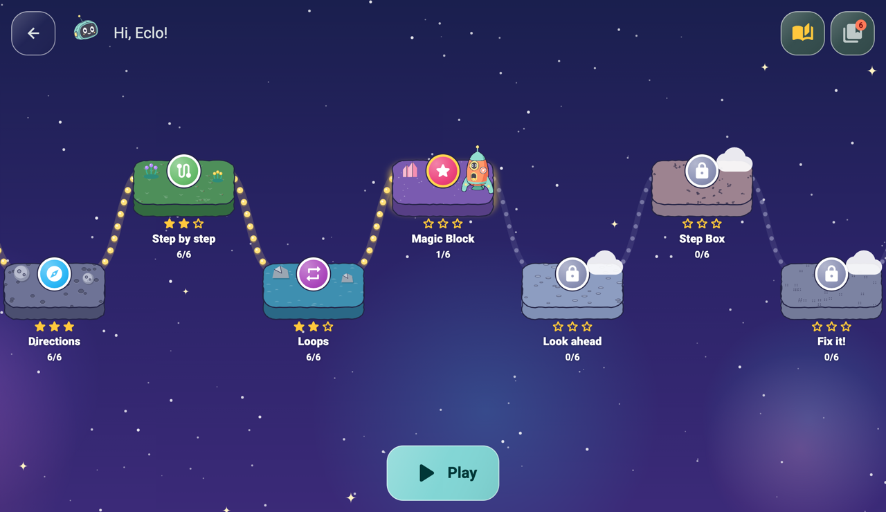<br>
      <b>Adventure map:</b> one planet per idea, with stars and a sticker book.
    </td>
    <td width="50%" valign="top">
      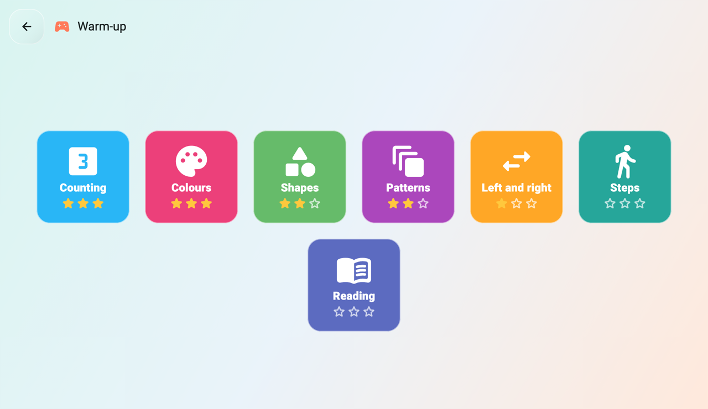<br>
      <b>Warm-up planet:</b> counting, colours, shapes, patterns, left and right, and steps.
    </td>
  </tr>
  <tr>
    <td width="50%" valign="top">
      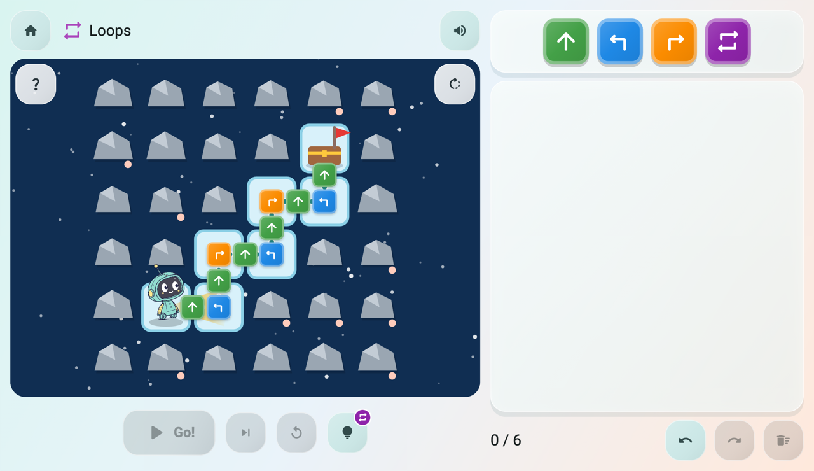<br>
      <b>Hint:</b> the level's own blocks along the route; asked again, the shape that repeats.
    </td>
    <td width="50%" valign="top">
      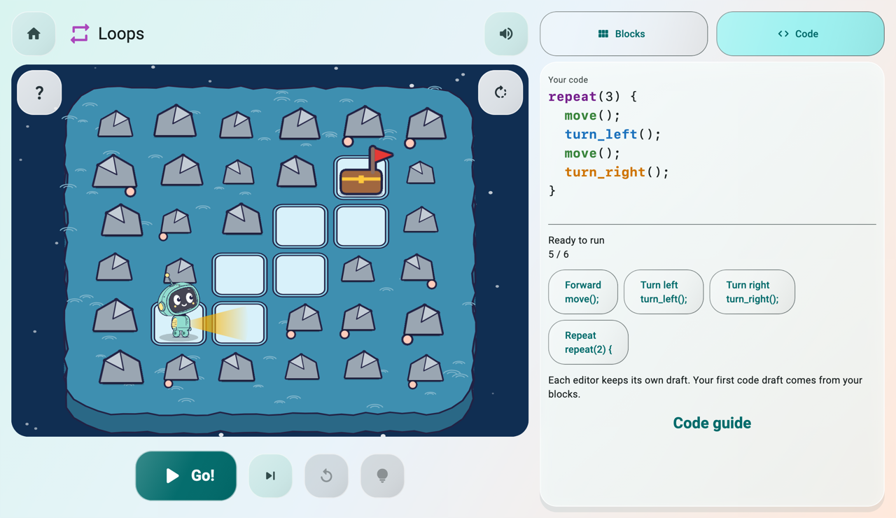<br>
      <b>Typed code:</b> readers type the program; commands share their blocks' colours.
    </td>
  </tr>
  <tr>
    <td width="50%" valign="top">
      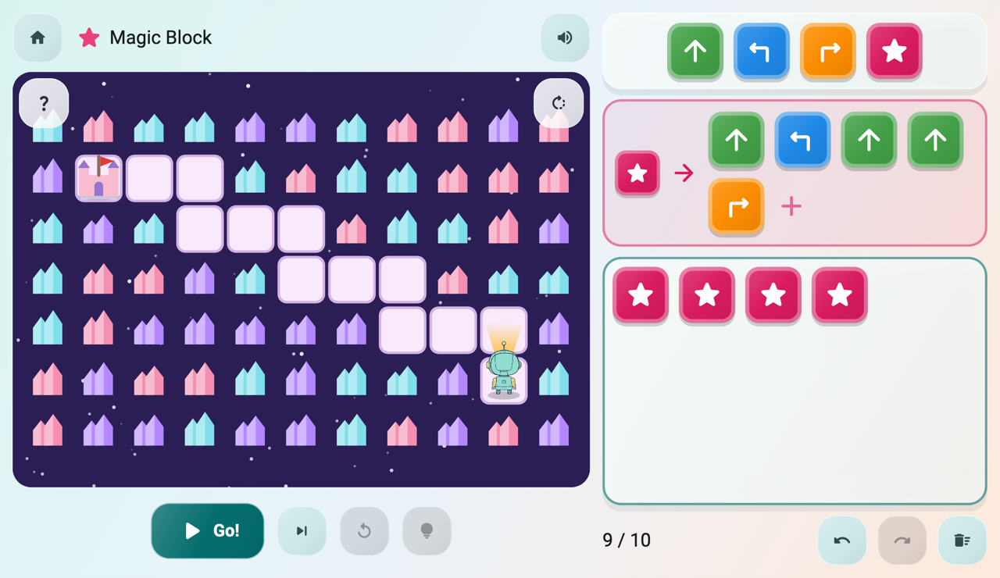<br>
      <b>Magic Block:</b> build your own block once, then use it again and again.
    </td>
    <td width="50%" valign="top">
      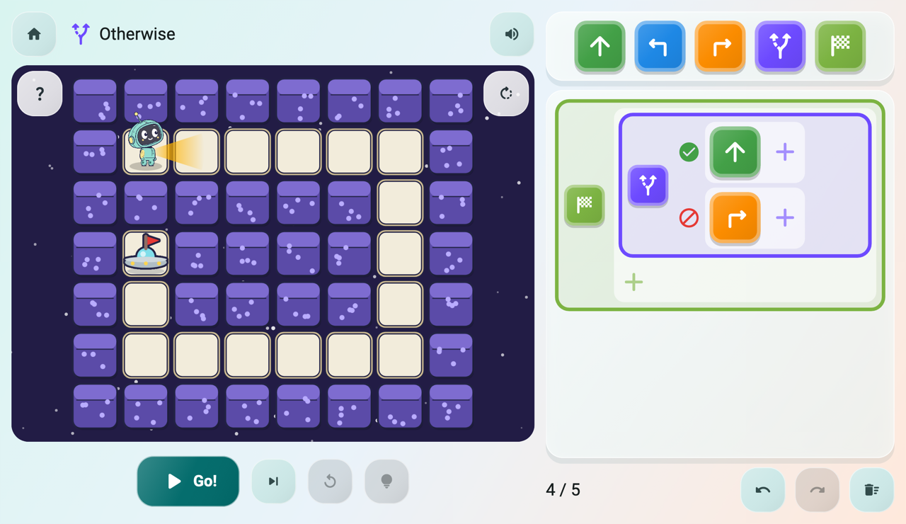<br>
      <b>Otherwise:</b> if the path is clear, step; otherwise, turn.
    </td>
  </tr>
  <tr>
    <td width="50%" valign="top">
      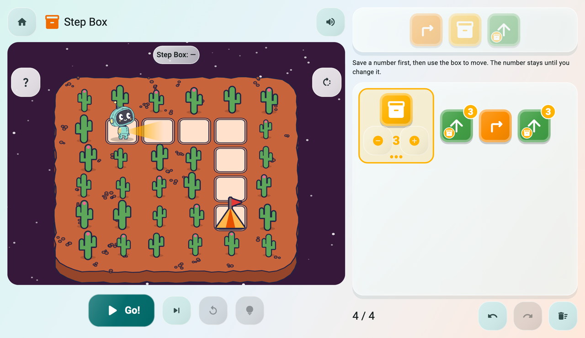<br>
      <b>Step Box:</b> save a number once and move by it.
    </td>
    <td width="50%" valign="top">
      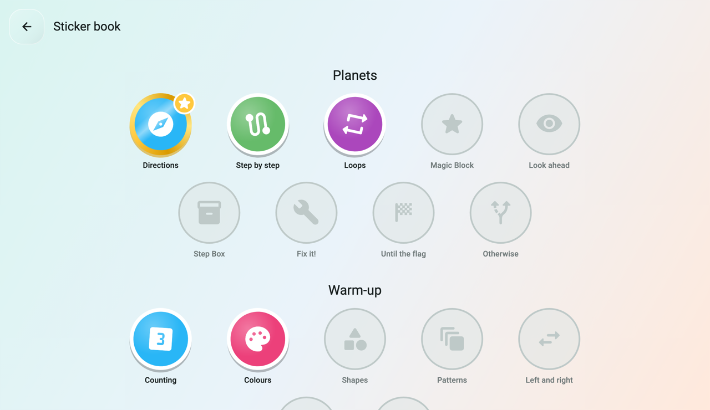<br>
      <b>Sticker book:</b> a sticker for every finished planet and Warm-up game.
    </td>
  </tr>
  <tr>
    <td width="50%" valign="top">
      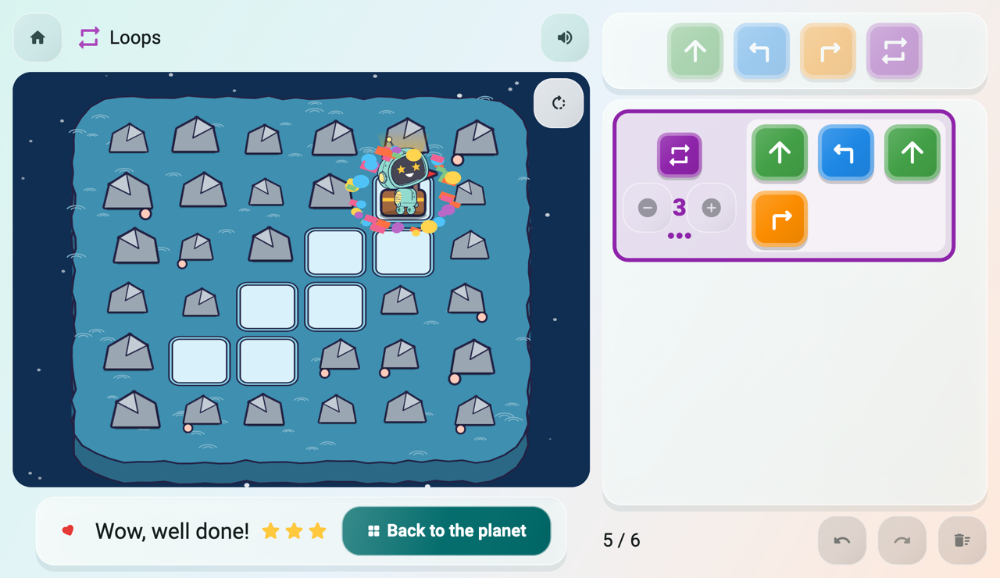<br>
      <b>Solved:</b> varied cheers, then back to the planet (or the map once the planet is complete).
    </td>
    <td width="50%" valign="top">
      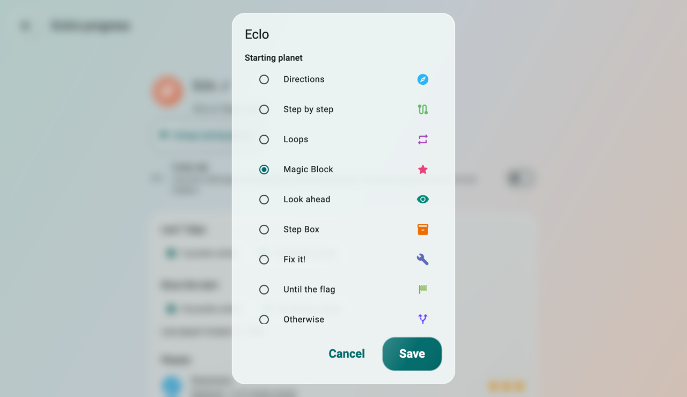<br>
      <b>Parent area:</b> behind a grown-up check; rename a player or change their picture, set the starting planet or replay the warm-up.
    </td>
  </tr>
  <tr>
    <td width="50%" valign="top">
      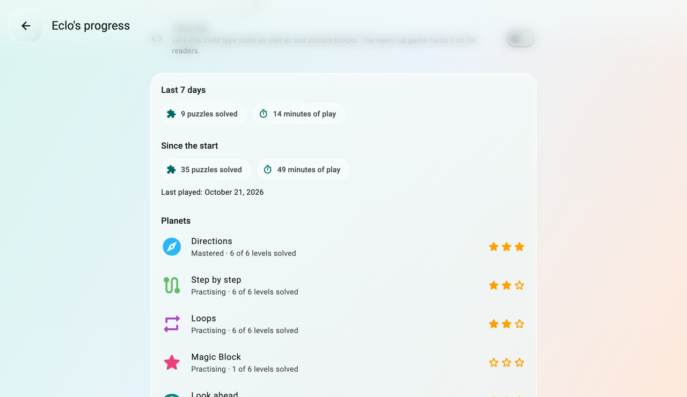<br>
      <b>Progress report:</b> (sponsor feature) puzzles, play time and every planet.
    </td>
    <td width="50%" valign="top">
      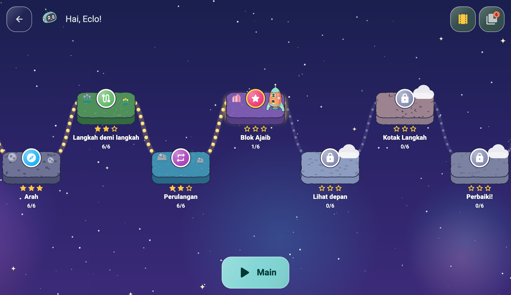<br>
      <b>Bahasa Indonesia:</b> every screen in Indonesian and English.
    </td>
  </tr>
</table>

## Getting started

Install the [Flutter SDK](https://docs.flutter.dev/get-started/install) (stable channel; built with Flutter 3.47.8) and the toolchain for your platform; `flutter doctor` checks it. Then:

```sh
flutter pub get
git config --local core.hooksPath .githooks   # commit-message check, once per clone
flutter run                                   # pick a device, or: flutter run -d chrome
```

Package name `cobalagi`, app ID `com.ardeman.cobalagi`.

Separate projects (the promo video project, the Dahlunas payment service) are found through `external-projects.json`: copy `external-projects.example.json` to it and point each section's `folder`, `readme` and `rules` at your checkouts. Like `.env`, the copy is not committed.

## Commands

| Task | Command |
| --- | --- |
| Run (debug) | `flutter run -d <device>` |
| Format, analyze, test | `dart format .`, `flutter analyze`, `flutter test` |
| On-device tests (real app and audio) | `flutter test integration_test -d macos` |
| End-to-end run with screenshots (new player, warm-up, story, a lesson, parent area) | `flutter test integration_test/app_flow_test.dart -d <device> > run.log`, then `dart run tool/collect_screenshots.dart run.log <folder>` |
| Release build | `flutter build <apk\|appbundle\|ipa\|web\|macos\|linux\|windows>` |
| Android APKs, one per architecture | `flutter build apk --release --split-per-abi` |
| Publish a GitHub Release by hand (`--dry-run` builds only; `--latest` for a full release) | `tool/release_apks.sh` |
| Linux and Steam Deck AppImage | `tool/build_appimage.sh` |
| Steam library artwork | `tool/steam_art.sh` |

**Checks**: run all three before every commit; they must pass with no errors or warnings:

```sh
dart format --set-exit-if-changed . && flutter analyze && flutter test
```

**Commit subjects** follow `type(scope)!: description`, with an optional scope and `!` for breaking changes. Types: `feat`, `fix`, `docs`, `style`, `refactor`, `perf`, `test`, `build`, `ci`, `chore`, `revert`. Example: `feat(profiles): add avatar picker`. The `.githooks/commit-msg` hook rejects other subjects, default merge and revert messages included.

## Project layout

```text
lib/
  main.dart        Opens storage, wires services, starts the app
  app/             App widget, router, theme, l10n (ARB files + generated code)
  core/            Shared services: storage, settings, entitlement, audio, responsive, gamepad, widgets
  engine/          Pure Dart: instruction set, levels, interpreter, solver and puzzle generator
  learning/        Pure Dart: skill graph, mastery, advance/practice/review rules, warm-up, stickers, story
  features/        One folder per feature (data/, cubit/, view/)
test/              Mirrors lib/
integration_test/  Tests that drive the real app on a device
tool/              Developer scripts: voice, sound, screenshots, releases, 3D models
branding/          Koba, the ship and the app icon (see branding/README.md)
store/             Store listings, changelogs, releases.json and slide rendering
website/           The site for cobalagi.ardeman.com
assets/config/     Skill map, learning thresholds, placement rules, warm-up games, demos, donations
assets/levels/     Hand-made lesson packs, one per concept
assets/audio/      Voice clips (<language>/<clipId>.mp3), sfx/ and music/
android/ ios/ web/ macos/ linux/ windows/   Platform runners, mostly generated
```

## Typed code

Readers can switch any puzzle to a small teaching language. It compiles to the same `Program` as the blocks, with the same lesson limits, and commands share their blocks' colours. Command names are the same in both languages:

```text
define star {
  move();
  turn_right();
}
repeat(3) {
  if_path_clear {
    move();
  } otherwise {
    turn_left();
  }
}
steps = 3;
move(steps);
until_flag {
  move();
}
star();
```

Repeats take counts from 1 to 9 and `//` starts a comment. Command buttons offer only the lesson's palette.

## Voice-over

Every clip is listed in `lib/core/audio/voice_clips.dart` with its words and its speaker: Koba (tours, goals, hints, cheers, demos, in the first person) or the narrator (warm-up questions, announcements, the story's narration). Missing clips are skipped silently. Clips live in `assets/audio/<language>/<clipId>.mp3` and are committed.

**ElevenLabs** makes the Indonesian, English, Javanese and Sundanese clips. Put the API key in `.env` (copy `.env.example`; git-ignored). Voices, models and settings are in `tool/elevenlabs.json` under `voices.<speaker>.<language>`. Shipping clips needs a paid plan with a commercial license.

```sh
dart run tool/generate_voice.dart --voices    # list voices in the account
dart run tool/generate_voice.dart --sample    # 5 sample lines per language, in build/voice_samples/
dart run tool/generate_voice.dart             # every missing clip
dart run tool/generate_voice.dart --only cheer_celebrate_1   # redo one clip
dart run tool/generate_voice.dart --speaker koba --force     # redo one speaker's clips
dart run tool/design_voice.dart               # Voice Design previews for Koba
dart run tool/design_voice.dart --save <generated_voice_id>  # keep a preview as a voice
```

### Regional languages

Javanese and Sundanese use direct text-to-speech with `eleven_v4`, following the user's sample review (Decisions, 2026-10-25). Generate their missing clips with `dart run tool/generate_voice.dart --lang jv` or `--lang su`. Javanese sets `language_code: jv`; Sundanese lets the model infer the language because it has no supported language code. Pronunciation and the draft texts still need a native speaker's review before release.

Acehnese and Minangkabau need native recordings (Decisions, 2026-10-24). Instead a native speaker reads the lines, and ElevenLabs speech-to-speech turns each reading into Koba's or the narrator's voice, keeping the pronunciation and removing background noise. These languages have `"recordings": true` in `tool/elevenlabs.json`. Raw recordings stay in the git-ignored `recordings/<language>/`.

```sh
# <lang> is ace (Acehnese) or min (Minangkabau)
dart run tool/record_voice.dart --lang <lang>                   # record at the Mac, in your own terminal
dart run tool/record_voice.dart --mics                          # list microphones; pick one with --mic <index>
dart run tool/record_voice.dart --lang <lang> --sheet           # script sheet for a speaker recording on a phone
dart run tool/record_voice.dart --lang <lang> --import <folder> # their files, named 001, 002…
dart run tool/generate_voice.dart --lang <lang> --sample        # convert 5 lines first, to listen
dart run tool/generate_voice.dart --lang <lang>                 # convert every recorded line
```

Sheet numbers follow `VoiceClips.all`, so make a new sheet when clips are added. Until every clip is recorded, a language plays the Indonesian clips and stays out of the language picker. Then list `assets/audio/<lang>/` in `pubspec.yaml` and drop `voiced: false` from its `AppLanguage`; `test/app/languages_test.dart` checks both.

### Sound effects, music and test voices

```sh
dart run tool/generate_sfx.dart               # missing sound effects (prompts in tool/sound_effects.json)
dart run tool/generate_sfx.dart --only goal   # redo one
dart run tool/generate_music.dart --force     # a new background theme (prompt in tool/music.json)
dart run tool/test_voices.dart                # placeholder clips from the Mac's voices (needs ffmpeg)
dart run tool/test_voices.dart --clean        # remove them
```

The API key needs the *Sound Effects* and *Music* permissions. Test voices may not ship: they leave the git-ignored marker `assets/audio/TEST_VOICES`, and release builds refuse to build while it exists.

After adding or replacing clips, Android builds may keep an old asset list: run `flutter clean` first.

## Release (Google Play)

**Once:** create an upload key and back it up outside this Mac, since updates can't be published without it.

```sh
"/Applications/Android Studio.app/Contents/jbr/Contents/Home/bin/keytool" -genkey -v -keystore ~/cobalagi-upload.jks -keyalg RSA -keysize 2048 -validity 10000 -alias upload
```

Then create `android/key.properties` (git-ignored); without it release builds are debug-signed, which Play rejects:

```properties
storeFile=/Users/<you>/cobalagi-upload.jks
storePassword=<password>
keyAlias=upload
keyPassword=<password>
```

**Play Console:**

- **Release track:** future releases go directly to Production after the checks and builds below. Closed testing was used to meet Google's requirement before the first launch; it is not part of the ongoing release workflow.
- **Donations:** one-time products with the ids in `assets/config/donations.json`. Prices: US $0.99, $2.99 and $4.99; Indonesia Rp 5,000, 19,000 and 49,000, the same as the App Store's tips. Any of them unlocks the sponsor plan. Test with license testers.
- **Families policy:** target audience children, no ads, no data collection, no internet permission. Privacy policy: `https://cobalagi.ardeman.com/privacy.html`.

### Bump and build checklist

1. **Version.** Raise the build number after `+` in `pubspec.yaml` by one. For the name, follow `AGENTS.md` → Version: if the previous build isn't live in a Google Play track yet, keep its name (`1.4.0+11` → `1.4.0+12`); otherwise raise MINOR for features or PATCH for fixes only.
2. **Release notes.** Write `store/changelogs/en-US/<build>.txt` and `store/changelogs/id/<build>.txt` (one `- ` line per change, plain words for parents, at most 500 characters, both saying the same), add `{ "build", "version", "date" }` to `store/releases.json`, then run `dart run tool/website_changelog.dart`.
3. **Listing text.** If a feature changes what `store/google_play/<locale>/full_description.txt` or `website/index.html` claim, update both languages.
4. **Screenshots.** Run `flutter test tool/screenshots --update-goldens`, `tool/screenshots/export.sh` and `store/render.sh`. Headless Chrome is sometimes killed mid-render (exit 137): run `store/render.sh` again until it exits 0 and `ls store/google_play/*/phone_screenshots/*.png store/google_play/*/screenshots/*.png | wc -l` gives 32.
5. **Drop render noise.** The solved and warm-up screens pick a random cheer and confetti on every render. If those screens didn't change, restore them: `git checkout -- 'store/google_play/*/6-solved.png' website/screenshots/solved*.png website/screenshots/phone-solved*.png website/screenshots/warm-up-pattern*.png website/screenshots/phone-warm-up*.png website/screenshots/warm-up-colors*.png website/screenshots/phone-warm-up-colors*.png`. Look at every other changed slide before keeping it.
6. **Checks and builds.** Run the Checks, then `flutter build appbundle --release` (for Play) and `flutter build apk --release --split-per-abi`.
7. **Tell the user what to upload:** the bundle path, the release notes, and which listing items changed (Store listing → Updating the Play listing), naming the Play Console field for each and marking slides that changed only slightly as optional. When the user says the listing is uploaded, mark that build `"listing": true` in `store/releases.json`.
8. **Commit and push only when asked**, as two commits: the feature work, then `build: bump version to <name>+<build>` with `pubspec.yaml`, `store/` and `website/`. Pushing the version change publishes the GitHub Release; watch it with `gh run watch $(gh run list --workflow release-apks.yml --limit 1 --json databaseId --jq '.[0].databaseId') --exit-status`.

### Checking UI changes

- **Renders:** `flutter test tool/screenshots --update-goldens --plain-name '<test>'` (for example `'tablet en map'`) draws a screen into `tool/screenshots/out/`. For a screen without a test, add a temporary `testWidgets` there and remove it with its `out/*tmp-*` images afterwards. Renders draw plain blurs, not liquid-glass shaders.
- **Emulators** (AVDs `Pixel_9a`, `Redmi_Pad_2`): start one with `~/Library/Android/sdk/emulator/emulator -avd <name> &`, drive the app from a temporary test in `integration_test/` (`flutter test integration_test/<file> -d emulator-5554`), print a marker at each step and grab `adb exec-out screencap -p` when it appears. Set orientation in the test with `SystemChrome.setPreferredOrientations`; the emulator's own rotation is unreliable.

## Launch updates

On Android the app asks Google Play for an update at launch and when it returns to the foreground. The splash waits up to two seconds; a later answer (within 30 seconds) shows on the player picker. The notice lets the child keep playing; updating needs the parent gate. Offline devices, missing stores and slow checks play on without a notice. Other platforms skip the check.

To test the real flow, install an older build from a Play test track, then make a higher version code available to that account ([Google's guide](https://developer.android.com/guide/playcore/in-app-updates/test)).

## macOS

```sh
flutter build macos --release --dart-define=GITHUB_RELEASE=true # GitHub build → build/macos/Build/Products/Release/Coba Lagi.app
flutter build macos --release --dart-define=APP_STORE=true      # Mac App Store build: tips, no unlock codes
```

- Needs macOS 12+ and Xcode. Plugins come through Swift Package Manager, without CocoaPods. **Apple Silicon only** (`ARCHS = arm64`): Xcode 27's `lipo -verify_arch` breaks Flutter 3.41's universal build; remove that setting once Flutter handles it.
- **Mac App Store upload:** run the App Store build command, then in Xcode (`macos/Runner.xcworkspace`) Product → Archive → Distribute App → App Store Connect. Signing is automatic.
- **GitHub build:** CI (`.github/workflows/macos.yml`) signs it with Developer ID, notarizes it and adds `CobaLagi-macOS.zip` to each release. Secrets: `MACOS_CERTIFICATE_P12_BASE64`, `MACOS_CERTIFICATE_PASSWORD`, `APPLE_API_KEY_P8`; without them the job skips with a warning. **The certificate expires on 2 February 2027:** before then, create a new one (Xcode → Settings → Apple Accounts → Manage Certificates → + → Developer ID Application) and replace both certificate secrets.
- Release builds run in the sandbox with no network (`macos/Runner/Release.entitlements`). The window opens at 1280 × 800 and can't shrink below 960 × 600.

## Linux and Steam Deck

```sh
tool/build_appimage.sh   # → build/release/CobaLagi-x86_64.AppImage (x86_64 Linux only; CI builds it for every release)
```

- One AppImage for Linux PCs and the Steam Deck, bundling GTK and GStreamer, built on Ubuntu 22.04 for the oldest glibc. Its name never changes, so updating is replacing the file.
- **Adding it to Steam:** each release carries `linux/steam/CobaLagi-Steam-Installer.desktop`. Double-clicked in Desktop Mode, it runs `linux/steam/CobaLagi-Steam-Installer.sh` from `master`, which downloads the newest AppImage into `~/Applications`, adds or updates a "Coba Lagi" non-Steam shortcut with its library artwork (`linux/steam/artwork/`, from `tool/steam_art.sh`) and adds "Uninstall Coba Lagi" to the menu. Running it again updates without duplicating. `STEAM_DIR=<folder>` points it at a test copy of Steam.
- **Controllers** work on every platform, without touching the screen; the button map is in `AGENTS.md` → Conventions, the code in `lib/core/gamepad/`. On the Deck a text field opens Steam's on-screen keyboard. In Steam, keep the controller layout on "Gamepad".
- The window opens at 1280 × 800 (the Deck's screen). Free plan only; unlock codes work.

## Windows

```sh
flutter build windows --release   # → build/windows/x64/runner/Release/cobalagi.exe (builds only on Windows)
```

- CI (`.github/workflows/windows.yml`) builds it whenever `windows/` or `pubspec.lock` changes, and adds `CobaLagi-Windows-x64.zip` (no install needed) to each release.
- Not code-signed yet, so SmartScreen warns on the first run (More info → Run anyway).
- Progress is saved under the company and product names in `windows/runner/Runner.rc`; changing them loses it. Free plan only; unlock codes work.

## Website

`website/` is published to [cobalagi.ardeman.com](https://cobalagi.ardeman.com) by GitHub Pages on every push to `master` that changes it (`.github/workflows/pages.yml`). Preview with `open website/index.html`, adding `?lang=en` or `?lang=id`.

## Branding

Koba, its ship and the app icon are built from the files in `branding/`; see [branding/README.md](branding/README.md). After changing the icon, run `branding/render.sh`.

## Store listing

**Google Play** (`store/google_play/<locale>/`, `id` and `en-US`): `title.txt` (30 characters), `short_description.txt` (80), `full_description.txt` (4,000), `feature_graphic.png` (1024 × 500), `screenshots/` (tablets, 1920 × 1080) and `phone_screenshots/` (1080 × 1920). Release notes for every store, GitHub and the website are in `store/changelogs/<locale>/<build>.txt`.

**Screenshots** come from the real app with sample data: `flutter test tool/screenshots --update-goldens && tool/screenshots/export.sh` renders every screen for the website and on every store device (`_devices` in `tool/screenshots/screenshots_test.dart`), and `store/render.sh` puts them in their device frames as slides. The frames are git-ignored: run `tool/fetch_bezels.sh` once on a new machine. Each set has eight slides, and every device appears held both ways at least once.

### Updating the Play listing

Play Console → Grow → Store presence → Main store listing, once per language: Indonesian (`id`, the default) and English (`en-US`, under "Manage translations").

| Play Console field | File |
| --- | --- |
| App icon | `branding/play_store_icon.png` |
| Feature graphic | `store/google_play/<locale>/feature_graphic.png` |
| Phone screenshots | `store/google_play/<locale>/phone_screenshots/1-…8-*.png` |
| 7-inch and 10-inch tablet screenshots | `store/google_play/<locale>/screenshots/1-…8-*.png` (the same set in both) |
| App name, short and full description | `title.txt`, `short_description.txt`, `full_description.txt` |
| Video | The landscape promo's YouTube link |
| Release notes (in the release) | `store/changelogs/<locale>/<build>.txt` |

Delete the old slides first (Play takes at most eight), then upload 1 to 8 in order. To see what changed since the listing on Play (the newest build marked `"listing": true` in `store/releases.json`): `git diff --stat $(git log -1 --format=%h --grep 'bump version to .*+<build>$') -- store/ branding/play_store_icon.png`.

### App Store listing

`store/app_store/<locale>/` (`id` first, `en-US`) holds one listing for iOS, iPadOS and macOS, in fastlane's file names: `name.txt` (30), `subtitle.txt` (30), `keywords.txt` (100, commas without spaces, no words from the name or subtitle), `promotional_text.txt` (170), `description.txt` (4,000) and `screenshots/{iphone,ipad,mac,duo}/`. `store/render.sh` also renders `header.png` and `search_result.png`. `test/store/store_text_test.dart` checks the limits and the words Apple forbids.

| App Store Connect setting | Value |
| --- | --- |
| Category | Education |
| Content Rights | No third-party content |
| App Privacy | Data Not Collected; privacy policy `https://cobalagi.ardeman.com/privacy.html` |
| Age rating | Parental controls yes, every capability and content question no (4+), then Made for Kids, ages 6–8 |
| Support URL | `https://cobalagi.ardeman.com` |
| App Review notes | Paste `store/app_store/review_notes.txt`; it answers the Kids Category questions up front. After replying to a review message: Update Review, then Resubmit |
| In-app purchases | Non-Consumable tips with the ids in `assets/config/donations.json`, at the same prices as on Play, with Family Sharing on |
| Text and screenshots | `store/app_store/<locale>/`, slides 1 to 8 in order |
| Header and Search Results | `header.png` and `search_result.png`, or the videos from the promo repo |
| Version release | Automatic, for iOS and macOS |

Upload iOS builds made with Xcode 27.1 or later, so the app reaches the iPhone Duo's screen edge.

### Promo videos

Promos are made in a separate repo, the video project (`video_marketing` in `external-projects.json`; its README has the commands and upload steps). This repo only records the gameplay frames they use, again whenever the demos or story scenes look different (about 30 minutes):

```sh
VIDEO_FRAMES=1 flutter test tool/screenshots --update-goldens --plain-name 'video frames'   # → tool/screenshots/out/video/
```

## Roadmap

**Done:** the engine, picture blocks and typed code; the learning loop and the warm-up placement; ten planets (Warm-up, Directions, Step by step, Loops, Magic Block, Look ahead, Step Box, Fix it!, Until the flag, Otherwise) with "Watch me!" demos; hints, stickers, sound, music and Koba's voice; the Star fuel story; game controllers and folding phones; releases on the App Store, Google Play's closed test and GitHub. The reasons behind each choice are in `AGENTS.md` → Decisions.

### Next: more platforms

Still to check on real devices once a release carries them:

- **iPhone and iPad:** split view and music mixing with other apps.
- **iPhone Duo:** the app folded and unfolded, upright and sideways; upload the Duo screenshots (`store/app_store/<locale>/screenshots/duo/`), required from April 2027.
- **Mac (GitHub build):** the zip opens without a warning on another Mac.
- **Windows:** starts, sound, saving, a controller and the minimum window size.
- **Steam Deck:** touch, the controls, the 1280 × 800 screen, audio and Game Mode.

### Next: Google Play production

Production access was granted on 2026-10-25, and version 2.9.0 (build 27) was submitted for a full production rollout in 177 countries/regions plus the rest of the world. Wait for Google's review and confirm the release is live. Managed publishing is off.

### Next: promo videos

1. **Upload** (by hand): the videos in the video project's `out/`, replacing the old YouTube promos, the shorts on every platform with their captions, and the App Store header and search-result videos.
2. **Landing page:** put Koba's short's YouTube ids in the `video-short` card in `website/index.html` (`data-video`/`data-en-video`, `href`/`data-en-href`), and the main promo's ids if it was re-uploaded.

### Next: buying on the website

Sponsors without store billing (GitHub builds) will buy through Dahlunas, Ardeman's payment service, which emails a signed code. Payments go through Midtrans in a shop on Dahlunas's own domain (Midtrans requires checkout on the shop's own site), so Coba Lagi only links to it. Dahlunas is a separate repo (`payment_service` in `external-projects.json`; `code_format` is the code's spec). The app side is done: "Have a code?" checks the code offline (`PurchasedCodes`, `lib/core/entitlement/purchased_code.dart`), only in builds made with `--dart-define=GITHUB_RELEASE=true` (`tool/release_apks.sh`, `tool/build_appimage.sh` and the macOS and Windows workflows pass it). Coba Lagi is Dahlunas project 1, and product 1 unlocks the sponsor plan (`purchased_codes` in `assets/config/donations.json`). The production public key (key id 2) is bundled. Key 1 is Dahlunas's sandbox key (`sandbox_public_keys`): anyone can get a sandbox code without paying, so only debug and profile builds take it, when made with `--dart-define=DAHLUNAS_SANDBOX=true`; release builds ignore it. To test a sandbox purchase, run `flutter run -d macos --dart-define=GITHUB_RELEASE=true --dart-define=DAHLUNAS_SANDBOX=true`, buy on Dahlunas's development service, and enter the emailed code under "Have a code?" in the parent area. `privacy.html` describes buying a code.

1. **Buying:** once Dahlunas's shop takes payments (it waits on Midtrans approving the account), a "Buy a code" link to `https://dahlunas.ardeman.com` on a support page of the website, and in the donation sheet (parent area, behind the parent gate, GitHub builds only).

### Next: regional languages

Javanese and Sundanese have generated voices and are offered in the language picker; their pronunciation and all regional texts still need a native speaker's review before release. Acehnese and Minangkabau need recordings and remain hidden (see Voice-over → Regional languages).

1. **Check the texts:** a native speaker reads each ARB file and fixes stiff words.
2. **Record the voices:** the user records Acehnese and Minangkabau. Convert, listen, then turn those languages on. Review the generated Javanese and Sundanese clips and replace any inaccurate lines.
3. **Tell people:** a release that turns a language on is a new feature (minor version) and goes in the release notes, both listings and the website.

### Later

- **Koba celebration clip** (a time-boxed test after the Play launch): an AI clip of Koba celebrating, turned into a sprite sheet for Flame's `SpriteAnimation` on the solved card. Keep it only if Koba still looks like Koba.
- **Progress export and import** (parent area, behind the parent gate): "Save progress" writes a file to the share sheet; "Load progress" on another device merges it (best stars kept, attempt logs combined). Nothing leaves the device unless a parent moves it. Cloud sync isn't planned: it would break the "no internet" promise.

## Documentation map

Each topic has one home. Update that file instead of copying its content elsewhere.

| File | Audience | Owns |
| --- | --- | --- |
| `README.md` | Everyone | Overview, setup, commands, layout, release steps |
| `AGENTS.md` | AI coding agents (and humans who want the rules) | Conventions, guardrails, definition of done, decisions |
| `CLAUDE.md`, `GEMINI.md` | Claude Code, Gemini CLI | Only an import of `AGENTS.md` |
| `branding/README.md` | Whoever changes the art | Koba, the ship and the app icon |
| `LICENSE`, `NOTICE.md` | Everyone | Terms for the code (GPL-3.0), and for sounds, art and the name |
| `website/` | Visitors of cobalagi.ardeman.com | The landing page, privacy policy and screenshots |
| `video_marketing.readme` in `external-projects.json` (separate repo) | Whoever makes the promo videos | Promo scripts, their YouTube text and uploads |
| `payment_service.readme` in `external-projects.json` (separate repo, Dahlunas) | Whoever works on purchases | Checkout, minting and the unlock code format |

Agents that follow the [AGENTS.md](https://agents.md) convention (Codex, Cursor, Copilot and others) read `AGENTS.md` directly.

## License

The code is free software under the [GNU General Public License v3.0 or later](LICENSE): you may use, study, share and change it, and anything you distribute that is built from it must be under the GPL too, with its source. Sounds, art and listing graphics are under CC BY-NC-ND 4.0, and the name and icon are not licensed for other apps; see [NOTICE.md](NOTICE.md). Third-party packages keep their own licenses.
